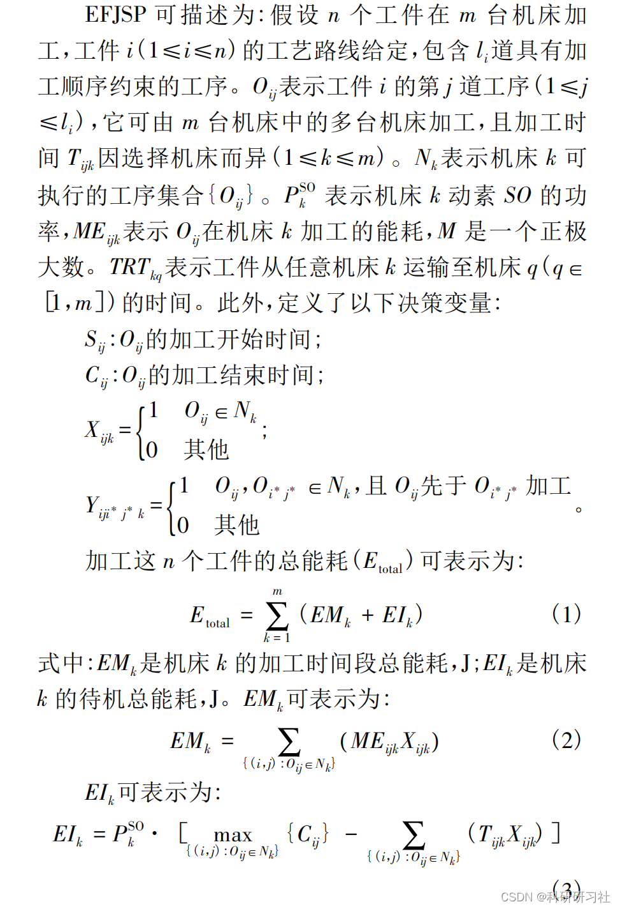
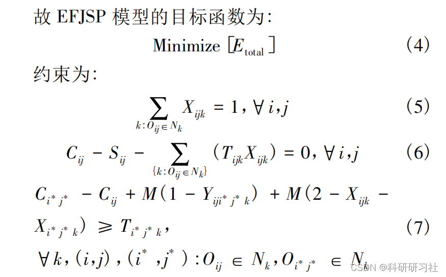
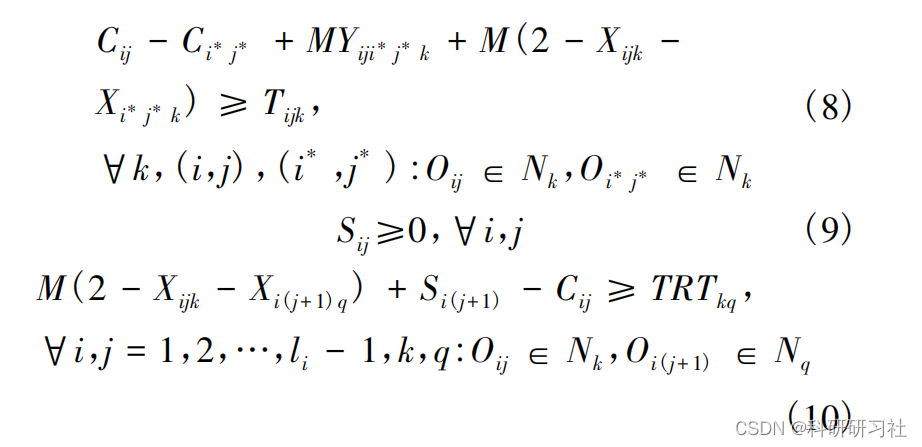
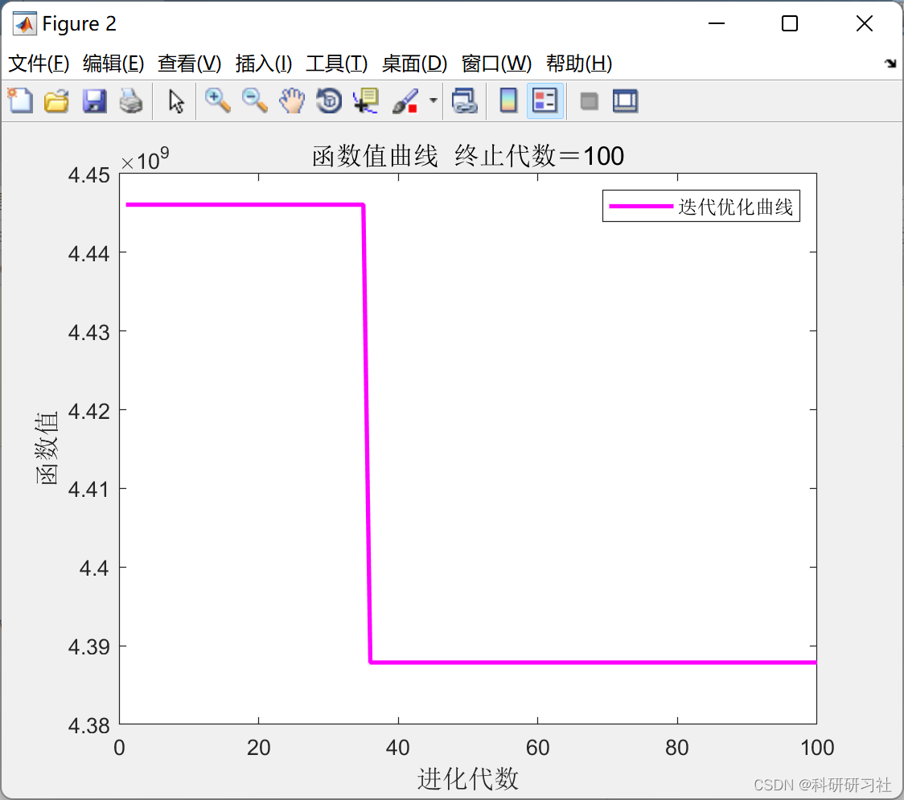
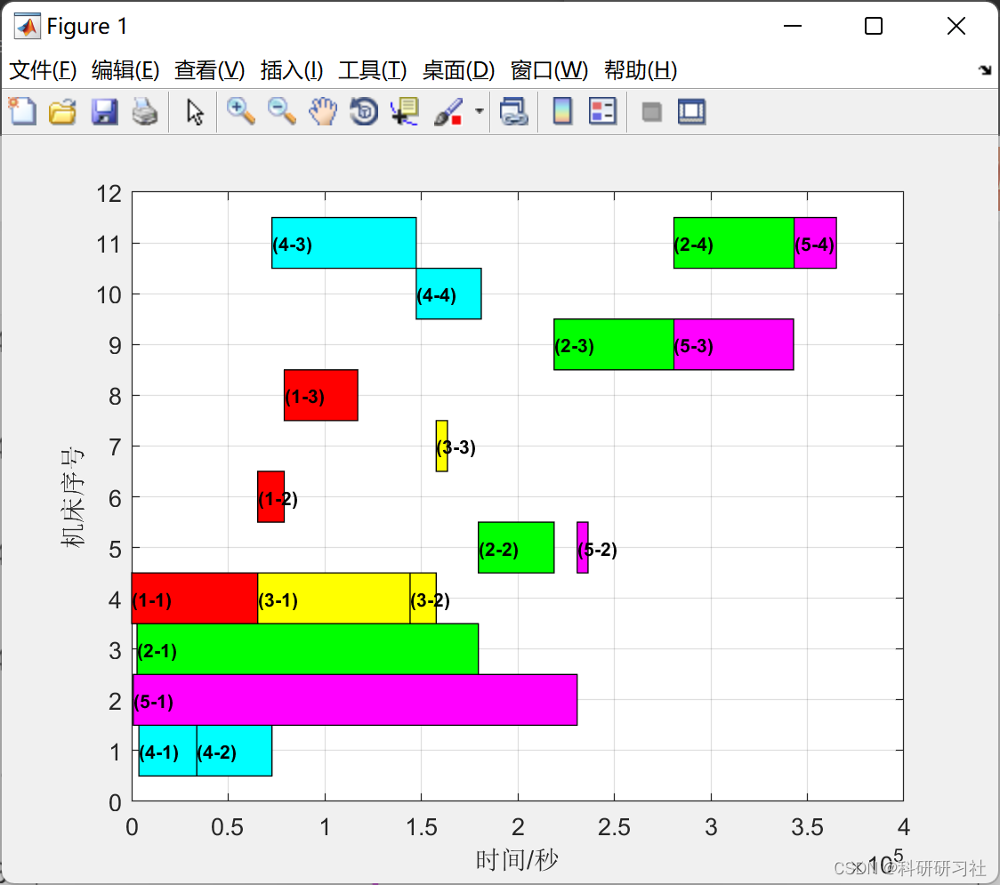

# Flexible Workshop Scheduling Based on Improved Genetic Algorithm (Matlab Code Implementation)

​  
1. Overview of the flexible job shop scheduling problem (FJSP) is an extension of the Job Shop Scheduling Problem (JSP). In previous studies on JSP and FJSP, transportation time has been largely ignored. Considering transportation time can lead to more realistic scheduling optimization results. Consequently, research on FJSP considering transportation time has increased. However, these studies have not considered the impact of transportation time on energy consumption. In FJSP, there are multiple machine tools available for each process step, leading to various possible transportation routes between adjacent processes, thus resulting in different transportation times. If the destination machine tool for a workpiece is in standby mode, reducing transportation time will obviously help reduce its standby energy consumption.
2. Model representation editing
Editor
Editor
Constraint equation (5) indicates that each process can only be processed by a single machine; equation (6) represents the processing start and end time intervals for each process as the processing time on the selected machine; equations (7) and (8) indicate that if two processes belong to different workpieces, their processing times cannot overlap when they are processed on the same machine; equation (9) states that the starting time of any process is non-negative; equation (10) indicates that processes belonging to the same workpiece have sequential constraints, and the starting time of each process is subject to transportation time constraints. For detailed explanations, refer to Part 4.
3. Running Results Editing
Editor
4. MATLAB code implementation
Flexible workshop scheduling based on genetic algorithm (Matlab code implementation)
function [y,release_time,T_start,T_need,T_end,T_total,T_jiagong,T_duidao,T_kongxian,P_total,P_jiagong,P_duidao,P_kongxian] = fun(x)\nnVar = numel(x);\nglobal Global info\n\n%% Arrange the workpiece for processing from start to end\nT_jiagong = 0;\nT_duidao = 0;\nT_kongxian = 0;\nT_start = zeros(Global.I,4); % Start time\nT_need = zeros(Global.I,4); % Processing time\nT_end = zeros(Global.I,4); % Completion time\nrelease_time = zeros(1,Global.M); % Next available time\n\nP_jiagong = 0;\nP_duidao = 0;\nP_kongxian = 0;\n\ncount_gongxu=ones(1,Global.I);\ncount_gongjian=zeros(1,Global.M); % Record the number of machine usages\nfor i=1:nVar/2\n    cur_gongjian = x(i);\n    cur_gongxu = count_gongxu(cur_gongjian);\n    count_gongxu(cur_gongjian) = count_gongxu(cur_gongjian)+1;\n    cur_machine = x(nVar/2+i);\n    cur_machine_code = info(cur_gongjian).gongxu(cur_gongxu).bianhao(cur_machine);\n    count_gongjian(cur_machine_code) = count_gongjian(cur_machine_code) + 1;\n    \n    if cur_gongxu==1 %The first process of the current workpiece\n        if release_time(cur_machine_code)>Global.Ai(cur_gongjian) % The current number of beds occupied\n            T_start(cur_gongjian,cur_gongxu) = release_time(cur_machine_code);\n            T_need(cur_gongjian,cur_gongxu) = Global.Ni(cur_gongjian)*sum(info(cur_gongjian).gongxu(cur_gongxu).data(cur_machine,2)) ...\n                + info(cur_gongjian).gongxu(cur_gongxu).data(cur_machine,3);\n            release_time(cur_machine_code) = release_time(cur_machine_code) + T_need(cur_gongjian,cur_gongxu);\n        else %The current machine is not occupied\n            T_start(cur_gongjian,cur_gongxu) = Global.Ai(cur_gongjian);\n            T_need(cur_gongjian,cur_gongxu) = Global.Ni(cur_gongjian)*sum(info(cur_gongjian).gongxu(cur_gongxu).data(cur_machine,2))  ...\n                + info(cur_gongjian).gongxu(cur_gongxu).data(cur_machine,3);\n            P_kongxian = P_kongxian + (T_start(cur_gongjian,cur_gongxu)-release_time(cur_machine_code))*Global.m_power(cur_machine,1);\n            T_kongxian = T_kongxian+(T_start(cur_gongjian,cur_gongxu)-release_time(cur_machine_code));\n            release_time(cur_machine_code) = T_start(cur_gongjian,cur_gongxu) + T_need(cur_gongjian,cur_gongxu);\n        end\n        T_jiagong = T_jiagong+Global.Ni(cur_gongjian)*sum(info(cur_gongjian).gongxu(cur_gongxu).data(cur_machine,2));\n        T_duidao = T_duidao+Global.Ni(cur_gongjian)*sum(info(cur_gongjian).gongxu(cur_gongxu).data(cur_machine,3));\n        P_jiagong = P_jiagong + info(cur_gongjian).gongxu(cur_gongxu).data(cur_machine,1)*Global.Ni(cur_gongjian);\n        P_duidao = P_duidao + info(cur_gongjian).gongxu(cur_gongxu).data(cur_machine,3)* ...\n            Global.m_power(cur_machine_code,2)*Global.Ni(cur_gongjian);\n        T_end(cur_gongjian,cur_gongxu) = T_start(cur_gongjian,cur_gongxu) + T_need(cur_gongjian,cur_gongxu);\n        \n    else % Not the first step\n        if release_time(cur_machine_code)>T_end(cur_gongjian,cur_gongxu-1) % The current number of beds occupied\n            T_start(cur_gongjian,cur_gongxu) = release_time(cur_machine_code);\n            T_need(cur_gongjian,cur_gongxu) = Global.Ni(cur_gongjian)*sum(info(cur_gongjian).gongxu(cur_gongxu).data(cur_machine,2)) ...\n                + info(cur_gongjian).gongxu(cur_gongxu).data(cur_machine,3);\n            release_time(cur_machine_code) = release_time(cur_machine_code) + T_need(cur_gongjian,cur_gongxu);\n        else\n            T_start(cur_gongjian,cur_gongxu) = T_end(cur_gongjian,cur_gongxu-1);\n            T_need(cur_gongjian,cur_gongxu) = Global.Ni(cur_gongjian)*sum(info(cur_gongjian).gongxu(cur_gongxu).data(cur_machine,2)) ...\n                + info(cur_gongjian).gongxu(cur_gongxu).data(cur_machine,3);\n            P_kongxian = P_kongxian + (T_start(cur_gongjian,cur_gongxu)-release_time(cur_machine_code))*Global.m_power(cur_machine,1);\n            T_kongxian = T_kongxian+(T_start(cur_gongjian,cur_gongxu)-release_time(cur_machine_code));\n            release_time(cur_machine_code) = T_start(cur_gongjian,cur_gongxu) + T_need(cur_gongjian,cur_gongxu);\n        end\n        T_jiagong = T_jiagong+T_need(cur_gongjian,cur_gongxu);\n        P_jiagong = P_jiagong + info(cur_gongjian).gongxu(cur_gongxu).data(cur_machine,1)*Global.Ni(cur_gongjian);\n        T_end(cur_gongjian,cur_gongxu) = T_start(cur_gongjian,cur_gongxu) + T_need(cur_gongjian,cur_gongxu);\n    end\nend\n\nnon_use = Global.M-numel(find(count_gongjian)==0);\n\nT_total = max(release_time);\nP_total = P_jiagong + P_duidao + P_kongxian;\nxishu = Global.xishu;\ny = sum([0.1*T_total P_total].*xishu) + non_use*1000000000;\n  
5 Conclusion This paper establishes an EFJSP model considering transportation time for the energy-saving operation of flexible workstations, and solves it using genetic algorithms. The established EFJSP model also reflects the method of achieving energy-saving operation in workshop manufacturing through machine selection and process sequencing. Case studies show that this method has good energy-saving effects. By reasonably selecting machining machines, the total energy consumption during the machining period can be reduced, while optimizing the sequence of process operations can reduce idle energy consumption of machines. Future research plans to consider the impact of random uncertain events (such as machine failures, new parts arrival) on production process energy consumption and improve the efficiency of intelligent algorithm solutions.
6 References [1] He Yusheng. Research on dynamic dispatch methods for flexible workstations considering energy consumption optimization [D]. Harbin Institute of Technology, 2016.  
[2] Zhang Zhongwei, Wu Lihui, Jia Shun. Research on energy-saving optimization of flexible workstations [J]. Manufacturing Technology and Machine Tools, 2019(04):162-168. DOI:10.19287/j.cnki.1005-2402.2019.04.032.

## Images

<!-- PAYMENT_BLOCK -->

## Get this dataset

- Payment link (Stripe): [Buy now](https://buy.stripe.com/3cs8yP7sY87d0vu9AB)
- Payment QR code: 

<!-- /PAYMENT_BLOCK -->
